<p align="center">
  
</p>

# 🛡️ URTC-GATEWAY

<p align="center"><a href="README.md">🇺🇸 English</a> | <a href="README_spa.md">🇪🇸 Español</a> | <a href="README_fra.md">🇫🇷 Français</a> | 🇮🇹 <b>Italiano</b> | <a href="README_deu.md">🇩🇪 Deutsch</a> | <a href="README_zho.md">🇨🇳 简体中文</a> | <a href="README_jpn.md">🇯🇵 日本語</a> | <a href="README_por.md">🇵🇹 Português</a></p>

### Un gateway davanti al bus CAN: gli identificatori che un host può inviare, un limite di frequenza e una chiave di sessione

<p align="center">
  
  
  
  
  
</p>

---

**Verifica di onestà - cosa funziona davvero oggi:** questo repository contiene un gateway scritto come software: l'elenco degli identificatori è ricavato dalla specifica del protocollo, il contenuto di ogni frame è controllato rispetto ad essa, la frequenza è limitata e un interlocutore deve dimostrare di possedere una chiave. Tutto è testato in CI con simulazioni e un socket locale. Non è mai stato collegato a un vero bus CAN, a un adattatore o a una scheda, e nessuna installazione lo usa ancora. Le teste di riscaldamento, laser e saldatura richiedono ancora le misure hardware del modello di minaccia: un interblocco che nessun frame possa chiudere, un bus chiuso e un arresto che tolga l'alimentazione.

---

> **Stato di sicurezza (safety e security):** questo ecosistema non è un sistema di sicurezza certificato e non esiste ancora alcuna scheda URTC assemblata. I bootloader controllano le immagini firmware con CRC32 e un HMAC-SHA256 a chiave condivisa, non con una firma asimmetrica (prevista); le immagini applicative pubblicate sono firmate con la chiave pubblica di sviluppo (`signing_key_kind: dev`), quindi chiunque può produrre un'immagine accettata dal bootloader; nulla è stato trasmesso a una scheda reale. Leggi la [base di sicurezza](https://github.com/JuanenRac/URTC-DOCS/blob/main/docs/SECURITY_BASELINE.md) e il [modello delle minacce](https://github.com/JuanenRac/URTC-DOCS/blob/main/docs/THREAT_MODEL.md) prima di fidarti di qualsiasi affermazione qui per la sicurezza di una persona.

## 📋 In breve

| | |
|---|---|
| Versione | `0.0.1` |
| Maturità | Impalcatura |
| Test | 75 |
| Tecnologia | Python / CAN / HMAC |
| Destinazione | Il PC di chi lo usa |
| Su hardware reale | Solo simulato: provato con emulatori, test double o simulatori; per questa versione non risulta alcuna esecuzione su hardware reale |

## 🎯 Panoramica

Il bus CAN della testa utensile non autentica il mittente: qualsiasi nodo collegato ai fili viene obbedito. Quando un'installazione non può tenere il bus chiuso, questo gateway si colloca davanti:

* **Elenco di identificatori, ricavato dalla specifica:** verso il bus passano solo gli identificatori che un host invia; quelli pericolosi (bootloader, aggiornamento dello slave di espansione, cancellazione dello stato salvato, ogni impostazione persistente) sono rifiutati a meno che l'operatore li sblocchi. [La tabella degli identificatori](docs/ALLOWED_IDS.md) è generata.
* **Controllo del contenuto:** un frame deve avere la lunghezza e i valori che la specifica consente (un setpoint nel suo intervallo, una direzione esistente, i byte magici dove sono richiesti).
* **Limite di frequenza:** un secchio di gettoni per identificatore e per l'intero collegamento, e uno più rigido per un identificatore pericoloso sbloccato.
* **Chiave di sessione:** un interlocutore dimostra di possedere una chiave con un HMAC su un nonce della connessione, un contatore e il frame, così nulla di registrato può essere riproposto.
* **Ogni protezione si può disattivare:** dal file di configurazione o dalla riga di comando, e il programma elenca all'avvio ogni protezione spenta. Non cifra e non sostituisce le misure hardware del modello di minaccia.

## 🧩 Ruolo in URTC

Il modello di minaccia del repository URTC dice che, se un'installazione non può tenere il bus chiuso o non può evitare di collegarlo a una rete, la protezione va in un gateway davanti al bus e non in ogni testa utensile. Questo repository è quel gateway: utile per un tunnel tra il controllore del robot e le teste utensile e per esporre il bus a una rete. Usa la specifica del protocollo di URTC-COMMON come unica fonte di identificatori e formati.

## 📂 Struttura del repository

```text
URTC-GATEWAY/
├── src/urtc_gateway/  il gateway: elenchi di identificatori, politica, limite di frequenza, chiavi di sessione, opzioni, estremità TCP e seriale, riga di comando
├── docs/              le opzioni (POLICY.md) e la tabella generata degli identificatori
├── tests/             test unitari di ogni protezione e un test su un vero socket locale
├── tools/             make_id_table.py e i controlli CI condivisi dell'ecosistema
├── images/            il banner
├── build.sh / build.bat, build-test.sh / build-test.bat, run.sh / run.bat
└── urtc.project.json, pyproject.toml, CHANGELOG.md, LICENSE
```

## 🛠️ COMPILAZIONE ED ESECUZIONE

**Requisiti:** Python 3.10 o superiore; pyserial solo per usare un vero adattatore SLCAN

```bash
python tools/make_id_table.py --check                              # la tabella degli identificatori è aggiornata
python -m pytest tests -q                                          # i test
python -m urtc_gateway.cli policy                                  # le opzioni effettive e un avviso per ogni protezione disattivata
python -m urtc_gateway.cli keygen keys.txt controller              # un nuovo file di chiavi (solo per il proprietario, mai sovrascritto)
python -m urtc_gateway.cli run --key-file keys.txt --bus loopback  # restare in ascolto su 127.0.0.1:8765 senza nulla sul bus
python -m urtc_gateway.cli run --key-file keys.txt --bus socket://127.0.0.1:7777# la scheda virtuale di URTC-COMMON (o qualsiasi URL pyserial) al posto di un adattatore
```

`build.sh` / `build.bat` alzano la versione di un passo (il contachilometri dell'ecosistema), installano il pacchetto ed eseguono i test; `build-test.sh` / `build-test.bat` verificano senza cambiare alcuna versione; `run.sh` / `run.bat` avviano la riga di comando (`policy`, `ids`, `keygen`, `run`).

## 🔗 Progetti correlati

URTC è fatto di repository indipendenti, ciascuno con la propria versione, i propri test e il proprio README. Ecco la famiglia, per gruppi:

* **URTC Tool Platform:** [URTC](https://github.com/JuanenRac/URTC), [URTC-COMMON](https://github.com/JuanenRac/URTC-COMMON), [URTC-FLASHER](https://github.com/JuanenRac/URTC-FLASHER), **URTC-GATEWAY** (questo repository), [URTC-SMART-RACK](https://github.com/JuanenRac/URTC-SMART-RACK), [URTC-TESTER](https://github.com/JuanenRac/URTC-TESTER), [URTC-VISION-TOOL](https://github.com/JuanenRac/URTC-VISION-TOOL), [URTC-WEB-STUDIO](https://github.com/JuanenRac/URTC-WEB-STUDIO)
* **Ecosystem Operations:** [URTC-DOCS](https://github.com/JuanenRac/URTC-DOCS), [URTC-UPDATER](https://github.com/JuanenRac/URTC-UPDATER)

**Oltre URTC:**

* **[HYDRA-UMC](https://github.com/JuanenRac/HYDRA-UMC)** - la scheda madre del braccio robotico, il cui relay CAN è documentato come il bus a cui si collega la testa utensile
* **[HYDRA-UMC-DOCS](https://github.com/JuanenRac/HYDRA-UMC-DOCS)** - la stessa idea per l'ecosistema HYDRA-UMC
* **[ARMOR-DOCS](https://github.com/JuanenRac/ARMOR-DOCS)** - la stessa idea per l'ecosistema di sicurezza A.R.M.O.R.
* **[JuanenRac](https://github.com/JuanenRac/JuanenRac)** - il profilo e il pannello di stato di tutti gli ecosistemi

## 📚 Documentazione e comunità

Dove leggere di più:

* [Politica: ogni opzione, il suo valore predefinito e come disattivarla](docs/POLICY.md)
* [Identificatori: cosa fa il gateway con ciascuno](docs/ALLOWED_IDS.md)
* [Registro delle modifiche di questo repository](CHANGELOG.md)
* [Licenza (GPL-3.0-or-later)](LICENSE)
* Domande, idee e segnalazioni: electrohobby3d@gmail.com

## 👤 AUTORE

**JuanenRac (Electro Hobby 3D)** · electrohobby3d@gmail.com

## 📜 LICENZA

GPL-3.0-or-later - vedi [LICENSE](LICENSE).
