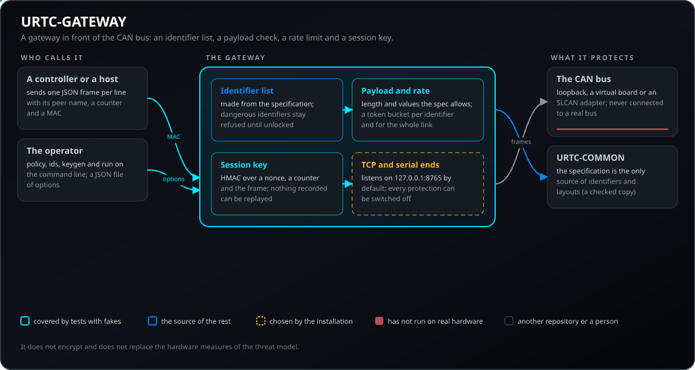
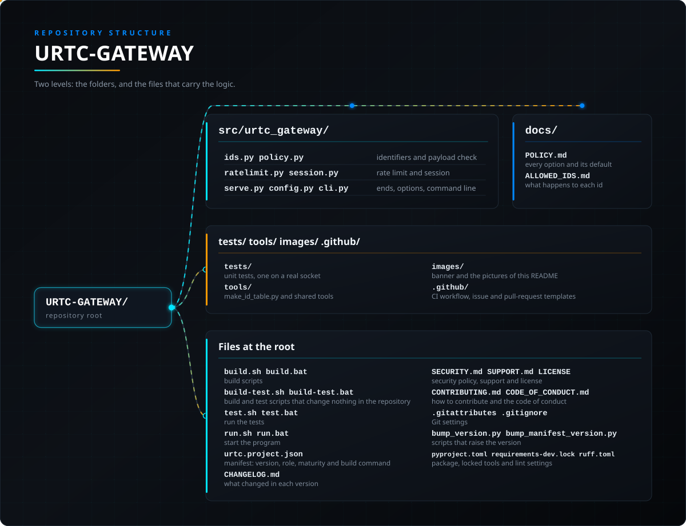

<p align="center">
  
</p>

# 🛡️ URTC-GATEWAY

<p align="center"><a href="README.md">🇺🇸 English</a> | <a href="README_spa.md">🇪🇸 Español</a> | <a href="README_fra.md">🇫🇷 Français</a> | <a href="README_ita.md">🇮🇹 Italiano</a> | <a href="README_deu.md">🇩🇪 Deutsch</a> | <a href="README_zho.md">🇨🇳 简体中文</a> | 🇯🇵 <b>日本語</b> | <a href="README_por.md">🇵🇹 Português</a></p>

### CAN バスの手前に置くゲートウェイ：ホストが送れる識別子、レート制限、セッション鍵

<p align="center">
  
  
  
  
  
  
</p>

---

**正直な現状確認 - 実際に今動くもの：** このリポジトリにはソフトウェアとして書かれたゲートウェイがあります。識別子の一覧はプロトコル仕様から作られ、各フレームの内容はそれと照合され、送信レートは制限され、相手は鍵を持っていることを証明しなければなりません。すべて CI で模擬部品とローカルソケットを使って試験しています。実際の CAN バス、アダプター、基板につないだことは一度もなく、これを使っている設置もまだありません。加熱・レーザー・溶接のヘッドには、脅威モデルにあるハードウェア対策が引き続き必要です。どのフレームでも閉じられないインターロック、閉じたバス、電源を切る停止装置です。

---

> **安全性とセキュリティの現状:** このエコシステムは認証された安全システムではなく、実装済みの URTC 基板もまだ存在しません。ブートローダーはファームウェアイメージを CRC32 と共有鍵の HMAC-SHA256 で検査しており、非対称署名ではありません(予定)。公開されているアプリケーションイメージは公開の開発用鍵(`signing_key_kind: dev`)で署名されているため、誰でもブートローダーが受け入れるイメージを作れます。実際の基板には何も送信されていません。ここに書かれた内容を人の安全のために頼る前に、[セキュリティベースライン](https://github.com/JuanenRac/URTC-DOCS/blob/main/docs/SECURITY_BASELINE.md)と[脅威モデル](https://github.com/JuanenRac/URTC-DOCS/blob/main/docs/THREAT_MODEL.md)をお読みください。

## 📋 ひと目で

| | |
|---|---|
| バージョン | `0.0.3` |
| 成熟度 | 足場段階 |
| テスト | 79 |
| 技術 | Python / CAN / HMAC |
| 対象 | 利用者の PC |
| 実機での確認 | シミュレーションのみ：エミュレーター、模擬部品、シミュレーターで試験済み。このバージョンについて実機での動作記録はありません |

**移動先：** [概要](#-概要) · [アーキテクチャ](#-アーキテクチャ) · [セキュリティ](#-セキュリティと安全) · [インターフェース](#-インターフェース) · [設定](#-設定) · [クイックスタート](#-クイックスタート) · [テスト](#-テスト) · [構成](#-リポジトリの構成) · [関連](#-関連プロジェクト)

<!-- urtc-section:status_gateway -->
## 🚦 プロジェクトの状況

🟢 完了・検証済み · 🟡 動作するが既知の制限あり · 🟠 途中、または未検証 · 🔴 未実施または動作しない。実機で一度も動いていないものは緑になりません。

| 項目 | 状態 | リポジトリが示せること |
| --- | :---: | --- |
| ソフトウェア | 🟡 | PC とシミュレーターでは動作します。実際のボードでは一度も実行していません。 |
| テスト | 🟡 | テストスイートはプッシュごとに CI で通ります。 |
| 実機 | 🟠 | 実際のボードでの実行はまだありません。ベンチテストは未実施です。 |
| セキュリティ | 🟡 | 許可リストにある ID だけを通し、頻度を制限します。PC 上で確認済みで、実際のバスの前では未検証です。 |
| ドキュメント | 🟡 | 8 言語の README と参照ドキュメントがあります。翻訳はネイティブによるレビューを受けていません。 |

<!-- /urtc-section:status_gateway -->

## 🎯 概要

ツールヘッドの CAN バスは送信者を認証しません。配線につながったどのノードにも従います。設置環境でバスを閉じておけない場合は、このゲートウェイをその手前に置きます。

* **仕様から作る識別子の一覧：** ホストが送る識別子だけがバスへ通ります。危険なもの（ブートローダー、拡張スレーブの更新、保存状態の消去、すべての永続設定）は、運用者が解除しない限り拒否されます。[識別子の表](docs/ALLOWED_IDS.md)は自動生成です。
* **内容の検査：** フレームは、仕様が許す長さと値でなければなりません（範囲内の設定値、存在する方向、必要な場所のマジックバイト）。
* **レート制限：** 識別子ごとと回線全体のトークンバケットがあり、解除した危険な識別子にはより厳しいものを使います。
* **セッション鍵：** 相手は、接続ごとのナンス、カウンター、フレームに対する HMAC で鍵を持っていることを証明します。そのため、録音したものは再生できません。
* **すべての保護はオフにできます：** 設定ファイルまたはコマンドラインで切り替え、起動時にオフの保護をすべて表示します。暗号化はせず、脅威モデルのハードウェア対策の代わりにもなりません。

## 🧩 URTC での役割

URTC リポジトリの脅威モデルは、設置環境でバスを閉じておけない、またはネットワークへの接続を避けられない場合、保護は各ツールヘッドではなくバスの手前のゲートウェイに置くべきだと述べています。このリポジトリがそのゲートウェイです。ロボットコントローラーとツールヘッドの間のトンネルや、バスをネットワークに公開する場合に役立ちます。識別子とレイアウトの唯一の情報源として、URTC-COMMON のプロトコル仕様を使います。

## 🏛️ アーキテクチャ

<p align="center">
  
</p>

このリポジトリの各部分の関係：誰が使い、何を持ち、何に依存するか。図は `docs/architecture.json` から描かれ、コードと照合されます。

## 🔒 セキュリティと安全

| 脅威 | 防御 |
|---|---|
| 配線上のノードが危険なコマンド（ブートローダー、拡張スレーブの更新、保存状態の消去、永続設定）を送る | 識別子リストは、オペレーターが `--unlock-dangerous` で解除するまで拒否します |
| プロトコルが許す範囲外の値（範囲外の設定値、存在しない方向、誤ったマジックバイト） | ペイロード検査がフレームを拒否します |
| 暴走した、または悪意のある送信者がバスを溢れさせる | 識別子ごとと回線全体のトークンバケット、解除した危険な識別子にはより厳しいもの |
| 記録したメッセージが再送される | セッションキー：接続のナンス、増え続けるカウンター、フレームに対する HMAC。記録は後でも別の場所でも役に立ちません |
| ゲートウェイがキーなしでネットワークから到達できる | セッションキーなしでローカル以外のアドレスで待ち受けることは、`--allow-open-network` を指定しない限り拒否されます |

暗号化はしません。バスは秘密ではありません。キーを持ちながら不正に振る舞うピアは止められません。そのためにリスト、ペイロード検査、レート制限、ツールヘッドのウォッチドッグがあります。CAN の脅威モデルのハードウェア対策（どのフレームでも閉じられないインターロック、閉じたバス、電源を切る停止）の代わりにはなりません。実際のバスでの使用経験はありません。

## 🔌 インターフェース

コマンドラインは `urtc-gateway`（または `python -m urtc_gateway.cli`）です。

| コマンド | 内容 |
|---|---|
| `policy` | 有効なオプションと、無効にした保護ごとの警告を表示します |
| `ids` | すべての識別子と、ゲートウェイがそれをどう扱うかを一覧します |
| `keygen FILE PEER [PEER ...]` | ピアごとに新しいランダムなキーを持つキーファイルを書き出します（所有者のみ読み取り可、既存ファイルは上書きせず、キーは表示しません）。各ピアには自分の行だけを渡します |
| `run` | TCP ポートで待ち受け（`--host` 既定 `127.0.0.1`、`--port` 既定 `8765`）、バスへ転送します（`--bus loopback`、`socket://127.0.0.1:7777` のような pyserial URL、または SLCAN アダプターのシリアルポート。`--bitrate` 既定 500000） |

**行プロトコル。** 接続時、ゲートウェイは `{"type": "hello", "nonce": "<hex>", "session": true}` を送ります。ピアが送る各メッセージは 1 行に 1 つの JSON オブジェクトです：`{"id": 304, "data": "012C", "peer": "controller", "counter": 1, "mac": "<16進32桁>"}`。`mac` は、ピアのキーによる `urtc-gw/1|<nonce>|<counter>|<3桁16進のid>|<16進データ>` の HMAC-SHA256 の先頭 16 バイトです。カウンターは接続中のメッセージごとに増える必要があり、ナンスは接続ごとに新しくなります。拒否されたメッセージには `{"type": "refused", "code": "<理由>"}` が返り、バスのフレームは `{"type": "frame", "id": ..., "data": "<hex>"}` として戻ります。[ポリシー](docs/POLICY.md)を参照してください。

## ⚙️ 設定

すべての保護は既定で有効で、どれも無効にできます。JSON の設定ファイル（`--config FILE`、`"schema": 1`。未知のセクションやオプション、誤った型、負のレートは、何が間違いかを示すエラーになります）とコマンドラインで設定でき、コマンドラインがファイルより優先されます。無効にした、または緩めた保護は、プログラム起動時に警告として一覧されます。

| 保護 | ファイルのセクション | 無効 / 有効 | 内容 |
|---|---|---|---|
| 識別子リスト | `whitelist.enabled` | `--no-whitelist` / `--whitelist` | ホストが送る識別子だけがバスに向かって通過します |
| 危険な識別子 | `whitelist.unlock_dangerous` | `--unlock-dangerous` | ブートローダー、拡張スレーブの更新、保存状態の消去、すべての永続設定は、解除するまで拒否されたままです |
| 追加・削除した識別子 | `whitelist.extra_allow`, `whitelist.deny` | `--allow-id`, `--deny-id` | 識別子を手動で追加する、または他の設定に関わらず外します |
| ペイロード検査 | `payload.enabled` | `--no-payload-check` / `--payload-check` | 長さと値は仕様が許すものでなければなりません |
| レート制限 | `rate.*` | `--no-rate-limit` / `--rate-limit` | 識別子ごとに毎秒 20 フレームとバースト 10、回線全体でバースト 50、解除した危険な識別子でバースト 2。`rate.overrides` で識別子ごとに独自のレートとバーストを指定 |
| セッションキー | `session.enabled`, `session.key_file` | `--no-session` / `--session`, `--key-file` | ピアがキーを持っていることを証明します |
| 送信側フィルター | `outbound.enabled`, `outbound.rate_hz` | `--no-outbound-filter` / `--outbound-filter` | ボードが送ったものだけがネットワークへ向かい、毎秒最大 500 フレームです |
| オープンネットワーク | `server.allow_open_network` | `--allow-open-network` | セッションキーなしでローカル以外のアドレスで待ち受けることは、求めない限り拒否されます |

```json
{
  "schema": 1,
  "session": {"enabled": true, "key_file": "keys.txt"},
  "rate": {"per_id_hz": 20, "per_id_burst": 10, "overrides": {"0x160": [5, 2]}},
  "whitelist": {"extra_allow": ["0x1B0"], "deny": []},
  "server": {"host": "127.0.0.1", "port": 8765}
}
```

## 🚀 クイックスタート

**必要なもの：** Python 3.10 以降。実際の SLCAN アダプターを使うときだけ pyserial が必要

```bash
python tools/make_id_table.py --check                              # 識別子の表が最新であること
python -m pytest tests -q                                          # テスト
python -m urtc_gateway.cli policy                                  # 有効なオプションと、オフの保護ごとの警告
python -m urtc_gateway.cli keygen keys.txt controller              # 新しい鍵ファイル（所有者のみ、上書きしない）
python -m urtc_gateway.cli run --key-file keys.txt --bus loopback  # バスに何もつながずに 127.0.0.1:8765 で待ち受ける
python -m urtc_gateway.cli run --key-file keys.txt --bus socket://127.0.0.1:7777# アダプターの代わりに URTC-COMMON の仮想ボード（または任意の pyserial URL）を使う
```

<!-- urtc-section:compatibility -->
### 要件と互換性

どのバージョンの URTC プログラムが連携して動作し、それぞれがどのプロトコルバージョンを話すかは、URTC-COMMON が生成する互換性表に載っています：[docs/COMPATIBILITY.md](https://github.com/JuanenRac/URTC/blob/main/docs/COMPATIBILITY.md)。`tools/changelog_section.py` を持つリポジトリ（ファームウェア、フラッシャー、テスター、アップデーター）のリリースノートは、そのバージョンの CHANGELOG の節にこの表を続けたものです：`python tools/changelog_section.py VERSION --compat`。
<!-- /urtc-section:compatibility -->

## 🧪 テスト

テストスイートは 79 件です（`python -m pytest tests -q`）。識別子リスト、ペイロード検査、レート制限、セッションとその拒否、オプションと設定ファイル、コマンドライン、実際のローカルソケットでのテスト、模擬ポートに対するシリアル側を検査します。任意の依存関係がない場合、1 件のテストはスキップされます。`python -m mypy` がパッケージの型を、`ruff check .` がソースを検査します。

## 🏗️ ビルドとリリース

`build.sh` / `build.bat` はパッケージをインストールしてテストを実行します。`build-test.sh` / `build-test.bat` はバージョンを変えずに検査します。`run.sh` / `run.bat` はコマンドライン（`policy`、`ids`、`keygen`、`run`）を起動します。`python tools/make_id_table.py` は仕様から [docs/ALLOWED_IDS.md](docs/ALLOWED_IDS.md) の識別子の表を書き出します（`--check` で比較）。

## 📂 リポジトリの構成

<p align="center">
  
</p>

<details>
<summary>ツリーのテキスト版</summary>

```text
URTC-GATEWAY/
├── src/urtc_gateway/                                ゲートウェイ：識別子リスト、ポリシー、レート制限、セッションキー、オプション、TCP とシリアルの端、コマンドライン
├── docs/                                            オプション (POLICY.md) と生成された識別子の表
├── tests/                                           各保護のユニットテストと実際のローカルソケットでのテスト
├── tools/                                           make_id_table.py と共有の CI・画像ツール
├── images/                                          バナーとこの README の画像
├── .github/                                         CI ワークフローと Issue・プルリクエストのテンプレート
├── build.sh build.bat                               ビルドスクリプト
├── build-test.sh build-test.bat                     リポジトリを変更しないビルド・テストのスクリプト
├── test.sh test.bat                                 テストを実行
├── run.sh run.bat                                   プログラムを起動
├── urtc.project.json                                マニフェスト：バージョン、役割、成熟度、ビルドコマンド
├── CHANGELOG.md                                     各バージョンの変更内容
├── SECURITY.md SUPPORT.md LICENSE                   セキュリティポリシー、サポート、ライセンス
├── CONTRIBUTING.md CODE_OF_CONDUCT.md               貢献方法と行動規範
├── .gitattributes .gitignore                        Git の設定
├── bump_version.py bump_manifest_version.py         バージョンを上げるスクリプト
└── pyproject.toml requirements-dev.lock ruff.toml   パッケージ、固定されたツール、lint 設定
```

</details>

## 🗺️ ロードマップと既知の制限

**現時点で分かっている制限**

* 実際の CAN バス、アダプター、ボードに接続したことはなく、これを使っている設備もまだありません。CI では模擬とローカルソケットで試験されています。
* 加熱、レーザー、溶接のヘッドには、引き続き脅威モデルのハードウェア対策が必要です。どのフレームでも閉じられないインターロック、閉じたバス、電源を切る停止です。
* 暗号化はせず、キーを持ちながら不正に振る舞うピアは止められません。

**次のステップ**

* 試験台でコントローラーと実際のツールヘッドの間で試します。まず仮想ボードの背後から始めます。

## 🌍 言語

README とテキストは、英語、スペイン語、フランス語、イタリア語、ドイツ語、中国語、日本語、ヨーロッパポルトガル語で提供されています。

## 🔗 関連プロジェクト

URTC は独立したリポジトリで構成され、それぞれに固有のバージョン、テスト、README があります。グループ別のファミリーは次のとおりです：

* **URTC Tool Platform:**
  * [URTC](https://github.com/JuanenRac/URTC) - ツールヘッド基板のファームウェア(25 のツールプロファイル、CAN ブートローダー)と CAN プロトコルのリファレンス。
  * [URTC-COMMON](https://github.com/JuanenRac/URTC-COMMON) - 一度だけデータとして書かれた CAN プロトコル(仕様、生成された表、適合ベクトル)と、各プログラムが共有するコード。
  * [URTC-FLASHER](https://github.com/JuanenRac/URTC-FLASHER) - CAN または SWD/JTAG で基板のファームウェアを更新するデスクトップツール。
  * **URTC-GATEWAY** (このリポジトリ) - CAN バスの手前に置くゲートウェイ。一覧にある識別子だけを通し、レートを制限し、セッション鍵を求めます。
  * [URTC-SMART-RACK](https://github.com/JuanenRac/URTC-SMART-RACK) - 予熱とライフサイクル追跡を備えたツールラック向けの、ハードウェア非依存の C ロジックとコマンドプロトコル。
  * [URTC-TESTER](https://github.com/JuanenRac/URTC-TESTER) - 基板が報告するツールプロファイルの操作部とテレメトリを表示する、デスクトップ用のライブ CAN バステスター。
  * [URTC-VISION-TOOL](https://github.com/JuanenRac/URTC-VISION-TOOL) - C のセンサーフレームプロトコルと、検査用ツールヘッド向けの Python サーマル/RGB コンパニオン。
  * [URTC-WEB-STUDIO](https://github.com/JuanenRac/URTC-WEB-STUDIO) - Web Serial と SLCAN で基板の書き込みとテストを行うブラウザアプリ。インストール不要。
* **Ecosystem Operations:**
  * [URTC-DEVTOOLS](https://github.com/JuanenRac/URTC-DEVTOOLS) - ファミリー共通のリポジトリツールを、版数付きの一つのセットとして提供します。ロックファイルで、編集されたコピーと古いままのコピーを見分けられます。
  * [URTC-DOCS](https://github.com/JuanenRac/URTC-DOCS) - エコシステムのアーキテクチャ、インターフェース、セキュリティベースライン、生成されたカタログと、全リポジトリを比較するツール。
  * [URTC-UPDATER](https://github.com/JuanenRac/URTC-UPDATER) - URTC ファミリーのリポジトリを検出・インストール・更新するデスクトップツール。操作は一つずつ明示的に行います。

**姉妹プロジェクト（独立しており、基盤とツールを共有）：**

* **[HYDRA-UMC-DOCS](https://github.com/JuanenRac/HYDRA-UMC-DOCS)** - 姉妹プロジェクト：HYDRA-UMC のドキュメントハブ。基盤とツールを共有する独立したエコシステム
* **[ARMOR-DOCS](https://github.com/JuanenRac/ARMOR-DOCS)** - 姉妹プロジェクト：A.R.M.O.R. セキュリティエコシステムのドキュメントハブ。こちらも独立し、同じ基盤の上にある
* **[JuanenRac](https://github.com/JuanenRac/JuanenRac)** - すべてのエコシステムのプロフィールとステータスダッシュボード

## 📚 ドキュメント

さらに読むには：

* [ポリシー：各オプション、既定値、オフにする方法](docs/POLICY.md)
* [識別子：ゲートウェイが各識別子をどう扱うか](docs/ALLOWED_IDS.md)
* [このリポジトリの変更履歴](CHANGELOG.md)
* [ライセンス（GPL-3.0-or-later）](LICENSE)
* 質問、アイデア、報告：electrohobby3d@gmail.com

## 🤝 コントリビュートとコミュニティ

* プルリクエストの前に `URTC_CI=1 python tools/ci_validate.py` を実行してください。通過する必要があります。[CONTRIBUTING.md](CONTRIBUTING.md) と[行動規範](CODE_OF_CONDUCT.md)を参照してください。
* README は 8 言語で提供されています。文章の変更は 8 つのファイルすべてで行い、他のリポジトリと共有するセクションは URTC-COMMON の `tools/readme_sections.py` が書き込みます。
* CAN プロトコルの変更は URTC-COMMON（`spec/can_protocol.json`）から始まり、検査済みのコピーを通じてこのリポジトリに届きます。
* ビルドしただけのものを、ボード上で動いているかのように書かないでください。
* 脆弱性は非公開で報告してください：[SECURITY.md](SECURITY.md)。質問、アイデア、報告：electrohobby3d@gmail.com（[SUPPORT.md](SUPPORT.md)）。

## 👤 作者

**JuanenRac (Electro Hobby 3D)** · electrohobby3d@gmail.com

## 📜 ライセンス

GPL-3.0-or-later - [LICENSE](LICENSE) を参照してください。
